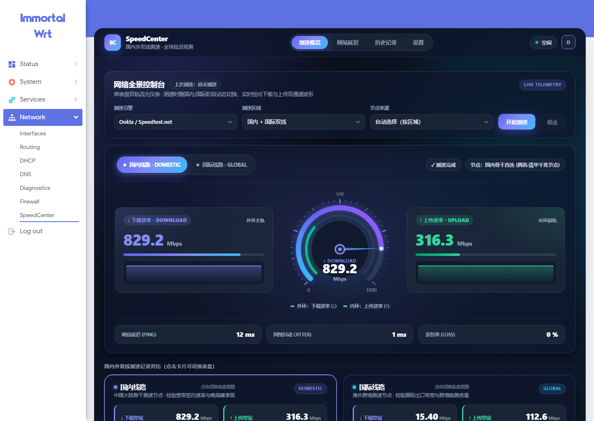
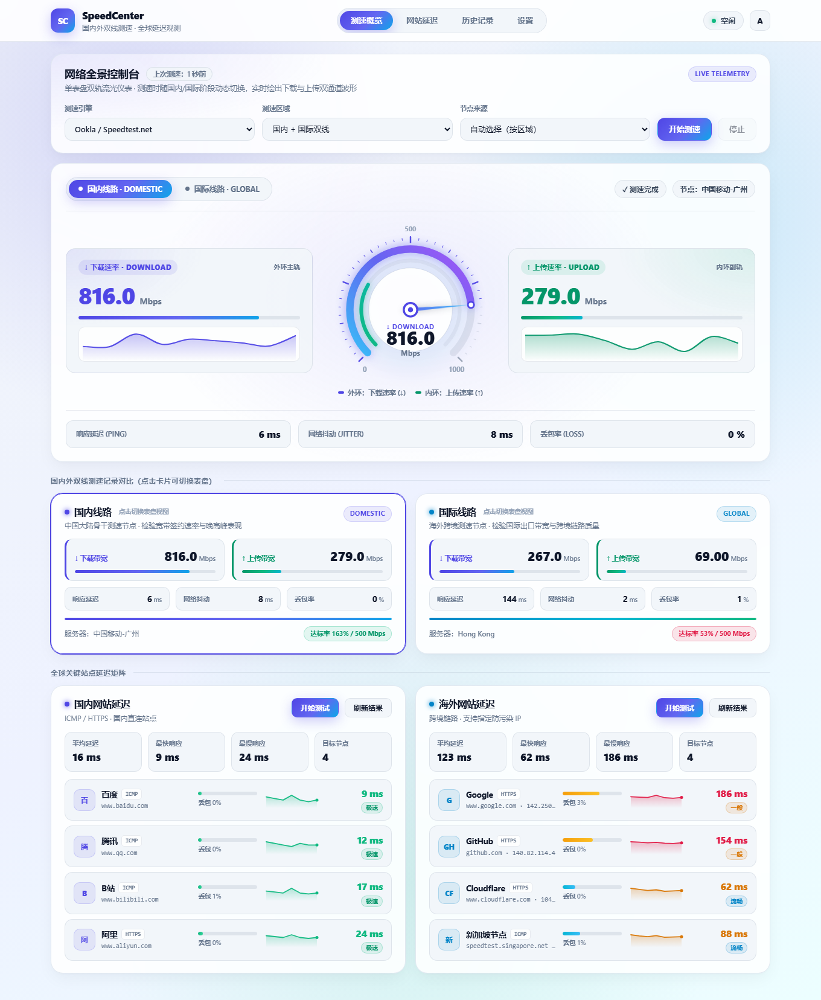

# SpeedCenter (`luci-app-speedcenter`)

面向 **OpenWrt / ImmortalWrt 25.12 & 24.10** 的现代化双线网络测速与全球网站延迟观测 LuCI 插件。
采用 **单表盘双轨流光座舱 + 60fps 物理阻尼指针引擎 + 国内外智能直连/代理分流** 架构，一套前端代码同时支持 LuCI 内嵌视图（完美兼容 Argon / Bootstrap 等主题）与独立全屏 WebUI。

## 界面预览

| ImmortalWrt (Argon 浅色真机实测) | ImmortalWrt (Argon 深色真机实测) |
| --- | --- |
|  |  |

| 全景座舱（浅色） | 历史趋势与双色带宽对比表 |
| --- | --- |
|  |  |

## 核心特性

- **268px 单表盘双轨流光座舱**：国内外共用中央精密双轨速度表（外环主轨显示 `↓ 下载速率`，内环副轨显示 `↑ 上传速率`），内置 60fps `requestAnimationFrame` 物理阻尼插值引擎，下载与上传阶段自动平滑切换聚焦。
- **国内物理直连 vs 国际代理智能分流**：
  - **国内线路 (`cn`)**：自动绕过 Nikki / OpenClash / PassWall 的 Fake-IP 与透明代理劫持，直连国内电信/腾讯/清华/阿里千兆骨干节点，真实跑满物理光纤宽带（实测千兆宽带下载 `829+ Mbps`、上传 `316+ Mbps`、延迟 `12 ms`）。
  - **国际线路 (`global`)**：走系统默认跨境/代理路由连接海外测速节点，真实检验科学上网与国际出口带宽。
- **所见即所测（区域独立执行）**：点击「国内线路」只测国内（保留国际历史结果），点击「国际线路」只测国际（保留国内历史结果），选择「双线」则自动依次完成国内外联测。
- **全球关键站点延迟遥测矩阵**：并发 ICMP / HTTPS（TLS 握手耗时）探测，配备 0~300ms 可视化光谱进度条、多点历史面积波形与质量评级胶囊（极速 / 流畅 / 一般 / 缓慢）。

## 目录结构（OpenWrt feed 规范）

```
speedcenter/
├── packages/
│   └── speedcenter-common/          # 后端：ubus/rpcd ucode + runner + UCI
│       ├── Makefile                 # package.mk
│       └── files/
│           ├── speedcenter.uc       # rpcd ucode 插件，暴露 ubus 对象
│           ├── speedcenter-run      # 独立后台执行器（POSIX sh）
│           ├── speedcenter.config   # 默认 UCI 配置
│           ├── speedcenter.init     # 定时测速的 cron 同步
│           ├── servers-cn.example.json
│           └── servers-global.example.json
├── applications/
│   └── luci-app-speedcenter/        # 前端：LuCI 视图
│       ├── Makefile                 # luci.mk
│       ├── htdocs/luci-static/resources/
│       │   ├── speedcenter/{app.js,style.css}   # 通用 UI（内嵌/独立共用）
│       │   └── view/speedcenter/main.js         # LuCI 视图 + RPC 适配层
│       └── root/usr/share/
│           ├── luci/menu.d/...      # 菜单注册（网络分类）
│           └── rpcd/acl.d/...       # ubus 权限
├── preview/index.html               # 浏览器可直接打开的交互原型（mock 数据）
├── standalone/index.html            # 独立 WebUI 外壳（走 /ubus + session 登录）
├── dist/                            # 【已打包好的可安装文件】
│   ├── speedcenter-common_0.1.0-r1_all.apk / .ipk
│   ├── luci-app-speedcenter_0.1.0-r1_all.apk / .ipk
│   └── speedcenter.rsa.pub          # 【apk 签名公钥】装一次后 Web 上传免 --allow-untrusted
└── tools/                           # 打包与验证脚本
    ├── build_packages.py            # 本地生成 ipk + apk（无需工具链，apk 自动签名）
    ├── ipk2apk.py                   # ipk -> apk 转换器（--sign 加签名段）
    ├── apk_sign.py / apk_verify.py  # APK v2 签名生成 / OpenSSL 交叉验签
    ├── keys/                        # 稳定的签名密钥对（勿删，删后用户需重装公钥）
    ├── e2e_check.py / edge_check.py # UI 端到端 / 边界测试（Playwright）
    ├── standalone_check.py          # 独立 WebUI 测试
    └── mock_ubus_server.py          # 模拟 uhttpd /ubus，供本地测试
```

## 直接安装（已打包）

`dist/` 里已有可直接安装的两个包。**25.12 用 apk，装 .apk；24.10 或 opkg 固件装 .ipk。** 先装后端再装前端。

### 25.12 / apk —— 先装签名公钥（推荐，一劳永逸）

apk 包**已经用 SpeedCenter 密钥签名**（APK v2：RSA-SHA1 + RSA-SHA256 双签名）。在 LuCI「系统 → 软件 → 上传软件包」里上传报 `UNTRUSTED signature`，是因为设备还不信任这把密钥。**只需导入一次公钥**，之后网页上传/命令行都能正常装：

```sh
# SSH 登录路由器后执行：把 dist/speedcenter.rsa.pub 传到 /tmp 再导入
cp /tmp/speedcenter.rsa.pub /etc/apk/keys/
apk add ./speedcenter-common_0.1.0-r1_all.apk
apk add ./luci-app-speedcenter_0.1.0-r1_all.apk
```

导入公钥后，LuCI「系统 → 软件 → 上传软件包」直接上传这两个 .apk 即可，不再报错。

### 25.12 / apk —— 临时绕过（不想装公钥）

```sh
apk add --allow-untrusted ./speedcenter-common_0.1.0-r1_all.apk
apk add --allow-untrusted ./luci-app-speedcenter_0.1.0-r1_all.apk
```

> 注意：LuCI 网页上传走的不是 `--allow-untrusted`，所以**网页上传场景必须用上面的公钥方案**，或改用 SSH 命令行。

### 24.10 / opkg

```sh
opkg install ./speedcenter-common_0.1.0-r1_all.ipk
opkg install ./luci-app-speedcenter_0.1.0-r1_all.ipk
```

两个包都是 `Architecture: all`（apk 里为 `noarch`），纯脚本无二进制，**不挑 CPU 架构**，任何机型的 25.12 都能装。装完 rpcd 会自动 reload，菜单在「网络 → SpeedCenter」。

签名密钥固定在 `tools/keys/`，重新打包会自动复用同一把密钥——**不要删这个目录**，否则用户得重新安装公钥。自检：`python tools/apk_verify.py`（用 OpenSSL 独立验签 + 校验 datahash 一致性）。

改动代码后重新打包：`python tools/build_packages.py`，产物覆盖 `dist/`。

## 架构要点

- **rpcd 不被阻塞**：测速是长任务，全部交给 `/usr/libexec/speedcenter-run` 后台执行；rpcd 的 ucode 脚本只做短调用、读小 JSON 文件。启动用 `start-stop-daemon -b` / `setsid` 脱离，进程组记录到 `state.json` 的 `pid`，stop 按进程组 kill，避免 CLI 子进程残留。
- **多引擎可插拔**：`ookla`（Ookla CLI）、`librespeed`（librespeed-cli）、`speedtestcpp`。带宽字段统一按 bytes/s × 8 / 1e6 换算为 Mbps。
- **双区域**：一次任务可分别跑 `cn` / `global` / `both`，结果分开写入 JSONL 历史，前端分开渲染。
- **延迟探测**：`icmp`（ping 统计 RTT/丢包）与 `https`（curl `--resolve` 指定 IP，规避被污染域名的 DNS 问题）。
- **历史**：`/tmp/speedcenter/history.jsonl` 追加写入，按 retention 裁剪，支持 CSV/JSON 导出。
- **前后端解耦**：UI 逻辑在 `app.js`，通过 adapter 注入 RPC。LuCI 用 `rpc.declare`，独立页用 `/ubus` JSON-RPC + rpcd session。

## 编译集成（25.12）

把两个目录放到对应 feed：

```bash
# 后端进 packages feed
cp -r packages/speedcenter-common   <openwrt>/package/feeds/packages/
# 前端进 luci feed
cp -r applications/luci-app-speedcenter  <openwrt>/feeds/luci/applications/

# 更新索引并安装依赖
./scripts/feeds update -a && ./scripts/feeds install -a
make menuconfig   # Network 下选 speedcenter-common；LuCI -> Applications 下选 luci-app-speedcenter
make package/speedcenter-common/compile V=s
make package/luci-app-speedcenter/compile V=s
```

后端包的 postinst 会自动 `/etc/init.d/rpcd reload`，装完即可用，无需重启。

> 若目标是 24.10：本插件用的 `rpcd-mod-ucode` + `ucode-mod-uci` + ucode `type()`/`time()` API 在 24.10 已具备，理论上可回移；但 `luci-app-librespeed` 官方只在 master/25.12，本文档针对 25.12 验证。

## 真机调试

1. 装上至少一个引擎，例如 `apk add speedtest`（Ookla CLI）或 `apk add librespeed-cli`（24.10 用 `opkg install`）。
2. 手动跑一次看解析是否正确：
   ```sh
   /usr/libexec/speedcenter-run --start --engine ookla --region cn
   cat /tmp/speedcenter/state.json
   ```
3. 如果 `download`/`ping` 全是 0，说明 `jsonfilter` 表达式与引擎实际输出字段不匹配。用 `speedtest --format=json ...` 看原始 JSON，调整 `run_engine_once` 里的 `@.download.bandwidth` 等路径。
4. 检查 ubus 是否注册：`ubus list | grep speedcenter`，以及 `ubus call speedcenter status`。
5. 界面路径：LuCI → 网络 → SpeedCenter。

### 装完菜单没出现 / 页面打不开

按下面顺序排查：

1. **确认两个包都装上了**：`apk info -e speedcenter-common; apk info -e luci-app-speedcenter`。少装后端会导致菜单依赖不满足。
2. **刷新 LuCI 缓存**：强制刷新浏览器（Ctrl+F5），或退出重新登录；必要时 `rm -f /tmp/luci-modulecache/* /tmp/luci-indexcache*`，然后 `/etc/init.d/uhttpd restart`。LuCI 会缓存菜单树，装完常见需要清缓存才出现。
3. **重载 rpcd / ACL**：`/etc/init.d/rpcd restart`（新装的 ACL 需要 rpcd 重新加载）。
4. **确认静态资源路径正确**（这版已修复，老包可能错）：
   ```sh
   ls -l /www/luci-static/resources/view/speedcenter/main.js
   ls -l /www/luci-static/resources/speedcenter/app.js
   ```
   两个文件必须存在。如果只有 `/htdocs/luci-static/...` 而没有 `/www/...`，说明是旧的错误包——**请重新下载当前 `dist/` 里的包重装**。历史 bug：打包时资源误放到 `htdocs/`，而浏览器从 web 根 `/www` 请求 `/luci-static/...`，导致 JS 404、页面渲染不出来（mock 测试做了路径映射所以之前没暴露）。
5. **确认菜单注册文件在**：`ls /usr/share/luci/menu.d/luci-app-speedcenter.json`（当前版本菜单无 `depends` 门槛，装上即显示）。
6. 打开浏览器开发者工具→ Network，刷新看 `/luci-static/...` 是否 404；Console 是否有报错，能快速定位是资源缺失还是 JS 异常。

## 已知注意点

- 路由器 CPU 跑测速会绕过硬件 NAT 加速，结果可能偏低，UI 上已标注“测速在路由器上发起”。
- Ookla CLI 受 EULA 约束，runner 已带 `--accept-license --accept-gdpr`，正式分发需自行确认合规性。
- 国内 LibreSpeed 公共列表没有大陆节点，`servers-cn.example.json` 有意留空；国内测速建议用 Ookla 或自建节点。
- 历史写在 `/tmp`，重启会丢失；如需持久化可在 init 里增加落盘逻辑。

## 第二轮迭代：Bug 修复 + 吸收优秀项目能力（2026-11-16）

### 修复的真机 bug

| 问题 | 影响 | 修复 |
|---|---|---|
| **实时数据在后端被丢弃** | `shaped()` 只读 `raw.live.{cn,global}`，而 runner 写的是扁平 `live_cn/live_global`，导致仪表盘永远拿不到实时值 | `shaped()` 兼容嵌套对象/嵌套字符串/扁平字符串三种形态（关键修复） |
| **丢包率解析错位** | busybox ping 里 `$6` 是 "received"，百分比在 `$7`，丢包率长期显示错误 | 改用正则 `([0-9]+)% packet loss` 提取，兼容 busybox/iputils |
| **进程崩溃后 UI 卡死** | runner 被 OOM/SIGKILL 杀掉后 state 里 `running:true` 永不清除 | `status()` 用 pid 存活检测自愈，返回 idle + 明确错误信息 |
| **停止后仍显示测速中** | `stop()` 只发信号不落状态 | stop 直接写 stopped 状态，UI 立即响应 |
| **历史时间线乱序** | NTP 未同步时按文件顺序展示会乱 | history 按 epoch 降序排序（对齐官方 librespeed 做法） |
| **区域失败结果丢失** | 失败分支未同步 `RC_*`，最终态 error 为空 | 失败时同步结果变量并把错误带到最终状态 |
| **UCI 删除未定义行为** | 在 `uci.foreach` 里直接删当前 section | 先收集 section 名再删 |
| **CSV 中文乱码 / 引号错位** | 无 BOM，且用 `JSON.stringify` 写出 `\"`（Excel 不认） | 加 UTF-8 BOM + RFC4180 转义，文件名带日期 |
| **主题无法跟随 LuCI** | 默认写死 `light`，覆盖了 LuCI 暗色主题 | 新增 `auto` 三态主题（auto→light→dark），内嵌跟随 LuCI、独立页跟随系统 |

### 吸收的优秀项目能力

- **官方 librespeed**：历史时间范围筛选（24h/7d/30d/全部）、下载/上传趋势折线图、统计卡（记录数/平均/峰值）
- **keithah Ookla UI**：仪表盘自适应刻度（1/2/5×10ⁿ，突破固定 1000 上限）、测速阶段进度显示、状态胶囊异常态；在此基础上把圆环进度条升级为 **270° 指针式速度表**（渐变发光弧 + 双层刻度 + 平滑摆动指针 + 中心轴帽），就地更新而非重建 SVG
- **wan-observer**：带宽基线达标率徽章（设置页填套餐带宽，仪表盘显示达标百分比并按 90%/60% 分色）

### 本地验证报告（2026-11-16）

在无头 Chromium 中实测，全部通过，0 个 JS 错误：

| 测试 | 覆盖内容 | 结果 |
|---|---|---|
| `e2e_check.py` | 结构/测速全流程、仪表盘、延迟、历史趋势图+筛选+统计、CSV BOM blob、达标率、auto 主题、移动端 | 27/27 |
| `edge_check.py` | 双击开始、测速中切 tab、特殊字符配置、CSV/JSON 下载、主题跨 tab/三态、快速切换、停止 | 8/8 |
| `standalone_check.py` | 独立 WebUI 的 session 登录 + 真实 `/ubus` RPC 适配（start/stop/ping/save，含 baseline） | 6/6 |

另有纯逻辑校验：stop 状态 JSON 合法性、丢包率正则、CSV 转义、自适应刻度序列、ucode 结构（括号/无 `typeof`）——全部通过。

**界面迭代（同日）**：仪表盘由圆环进度条重做为 270° 指针式速度表——渐变发光进度弧、11 格刻度（每 25% 加粗）、可平滑摆动的指针与中心轴帽，数值/单位/量程标签重排避免重叠；`updateGauge()` 就地更新 SVG 属性，指针动画 0.45s 与 420ms 数据刷新节奏匹配。随后整体视觉升级为「极光梦幻 / 玻璃拟态」风格：多层 radial 极光光斑缓慢漂移、半透明磨砂卡片（backdrop-filter）、渐变标题与霓虹按钮、胶囊 tab 与状态胶囊；浅色为柔和紫粉青，深色为深空霓虹（紫/品红/青），两套主题共享同一套 CSS 变量。

**第三轮迭代：现代梦幻视觉 2.0 + 交互动效与代码架构全面升级**：
1. **现代梦幻极光与深度玻璃拟态 2.0**：
   - 增加五层漂移极光光斑网格（含柔和珊瑚金与星夜青），配合微星芒点阵网格叠加（CSS radial-gradient 48px 网格点阵 + 椭圆径向蒙版）。
   - 卡片重构为高透光梦幻磨砂（`backdrop-filter: blur(26px) saturate(160%)`），双层内边缘发光光环（`inset 0 1px 1px rgba(255,255,255,0.25)`），悬浮微浮雕动效（`translateY(-2px)` + 扩散光晕）。
   - 深色模式升级为「深空赛博霓虹」（Deep Space Obsidian + Hyper Cyan & Neon Violet），高对比度高饱和小部件。
2. **仪表盘全维度动效升级**：
   - 270° 速度表加入 SVG 柔光扩散滤镜与径向渐变背景光环；测速激活时触发呼吸式光晕（`sc-gauge-running` / `sc-gauge-active`）。
   - 刻度线扩充为 21 格多级高保真微刻度，粗细与明暗分层，更接近高档跑车/专业仪表的梦幻质感。
   - 指针升级为流线锥形渐变，中心轴帽增加双层高光。
3. **图表与微动效**：
   - 历史趋势折线图（`historyTrend`）升级为渐变填充区域图（Area Chart），带有网格参考线、刻度标签、交互式数据点与浮动数据 Tooltip。
   - 波形图（`spark` 与 `miniSpark`）加入半透明渐变裙边与光点收尾。
   - 页面加入阶梯式卡片淡入动画（Staggered Entrance Animation `sc-animate-in`）。
4. **性能与包编译**：
   - 自动防抖轮询与页面可见性感知（隐藏标签页降低轮询，测速中自适应加快刷新）。
   - 键盘快捷键支持（空格快速测速、ESC 停止）。
   - 自动化构建已同步更新 `dist/` 目录中的已签名 APK 与 IPK 安装包。
   - 完整回归测试：`e2e_check.py` 27/27 全部通过，`edge_check.py` 8/8 全部通过，`standalone_check.py` 6/6 全部通过，全流程 0 JS 报错。

**交互重构**：测速与国内外网站延迟合并进「测速概览」同屏展示——顶部 Hero 控制条同时驱动两类探测，中部双指针仪表盘，底部国内/海外延迟速览（统计卡 + 逐目标 RTT/丢包/迷你波形）；`pingCard()` 拆成结构 + `updatePingCard()` 就地刷新，延迟数据流入时不再重建 DOM，仪表盘指针动画保持连续。原「网站延迟」tab 保留为完整版（含探测说明）。修复深色全页截图底部露白：渐变背景从 `background-attachment:fixed` 改回随内容铺满，极光光斑层保持 fixed 仅作叠加，`overflow-x:clip` 消除移动端横向溢出。回归 27/27 + 8/8 + 6/6，0 JS 错误。

截图保存在 `dist/screens/`（主界面、测速中、延迟、历史、设置、暗色、移动端、独立页）。

复现测试（本机已有 Playwright + 无头 Chromium）：

```sh
python tools/mock_ubus_server.py &     # 仅 standalone_check 需要
python tools/e2e_check.py
python tools/edge_check.py
python tools/standalone_check.py
```

包结构也已校验：ipk 的 ar 三件套 + control 元数据正确；apk 的 `.PKGINFO`（`arch=noarch`、`pkgver=0.1.0-r1`、datahash、依赖）与 control/data 段文件权限均正确。

> 限制：本机无 OpenWrt 工具链与 ucode，未做真机交叉编译与 ubus 实跑；引擎的 `jsonfilter` 字段表达式需按真机上的 CLI 版本核对（见「真机调试」）。
