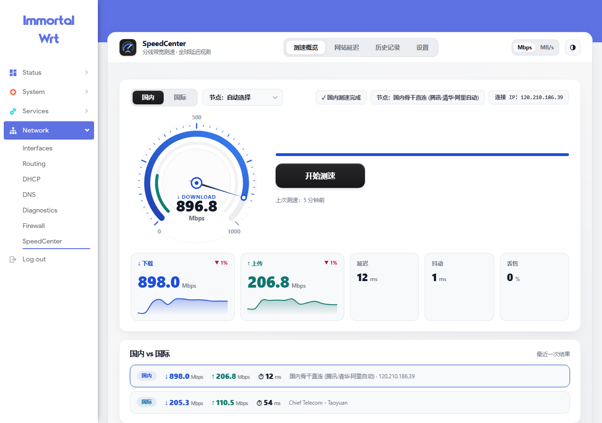
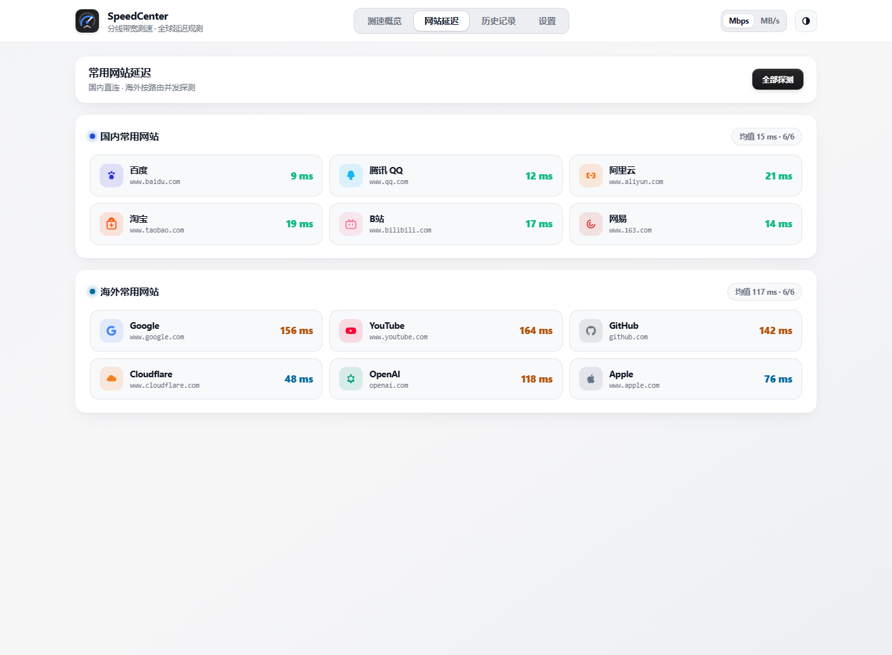
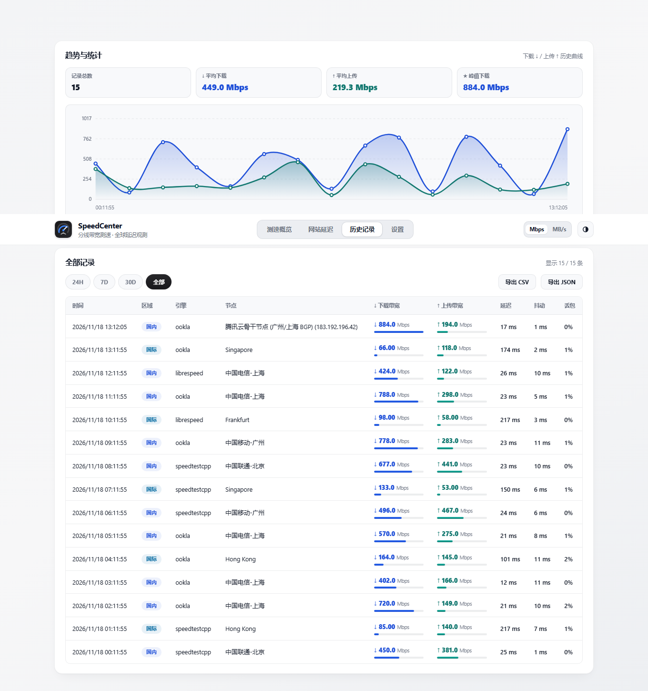
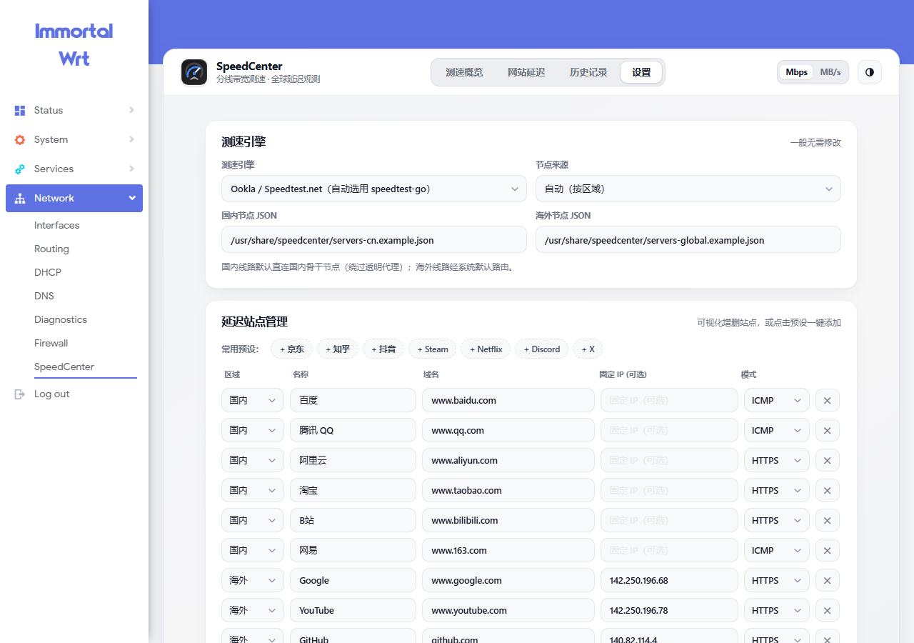

# SpeedCenter (`luci-app-speedcenter`)

面向 **OpenWrt / ImmortalWrt 25.12 & 24.10** 的现代化分线网络测速与常用网站延迟监测 LuCI 插件。  
采用模块化前端架构、60fps 时间归一化阻尼双环指针表盘与国内外分线直连/路由策略，一套前端同时支持 LuCI 内嵌视图（适配 Argon / Bootstrap 等主题）与独立 WebUI。

## 界面预览

| ImmortalWrt (Argon 浅色真机实测) | ImmortalWrt (Argon 深色真机实测) |
| --- | --- |
|  |  |

| 常用网站延迟卡片（品牌图标 + 紧凑排版） | 历史趋势与记录统计 |
| --- | --- |
|  |  |

| 可视化延迟站点编辑器（预设一键添加 + 行内编辑） |
| --- |
|  |

---

## 核心特性

- **精密双环表盘与 60fps 平滑动画**：外环显示下载速率、内环显示上传速率，自适应量程刻度（`1 / 2 / 5 × 10ⁿ`），测速聚焦模式下自动隐藏次要卡片。
- **国内 / 国际分线单独测速**：
  - 每次只测当前选中的单一区域（`国内` 或 `国际`），互不覆盖另一侧历史展示。
  - **国内测速 (`cn`)**：绕过 Nikki / OpenClash 等透明代理，直连国内千兆骨干镜像节点并发压测（下载持续 8 秒、上传持续 7 秒，EMA 平滑采样）；支持 **自动选择（腾讯·清华·阿里聚合）**、**腾讯云骨干节点**、**清华大学 TUNA 节点**、**阿里云多线节点** 四个可选选项。
  - **国际测速 (`global`)**：支持 `speedtest-go` / Ookla / `librespeed-cli`，经路由器当前默认出口策略测速。
- **实时显示实际连接 IP**：测速过程中及完成后在顶栏显示实际连接的测速服务器 IP（`连接 IP：xxx.xxx.xxx.xxx`），方便确认链路归属。
- **网速单位一键切换 (`Mbps` ↔ `MB/s`)**：顶栏开关实时切换主表盘刻度与数值、指标卡片、国内外对比条、历史曲线及表格单位，自动记忆偏好。
- **常用网站延迟监测**：预置 12 个国内与海外常用站点（百度、腾讯 QQ、阿里云、淘宝、B站、网易；Google、YouTube、GitHub、Cloudflare、OpenAI、Apple），内置离线 SVG 品牌图标与 3 列紧凑卡片布局。
- **可视化延迟站点编辑器**：在「设置」页支持行内增删改监控目标（区域 / 名称 / 域名 / 固定 IP / ICMP 或 HTTPS 模式），提供京东、知乎、抖音、Steam、Netflix、Discord、X 等一键预设，并保留可折叠的 CSV 批量文本导入。
- **持久化历史记录与定时任务**：历史记录持久化保存在 `/etc/speedcenter/history.jsonl`（路由器重启不丢失），支持 `24H / 7D / 30D / 全部` 筛选、UTF-8 BOM CSV 与 JSON 导出，以及 `6h / 12h / 1d / 7d` cron 定时测速和套餐达标率统计。

---

## 详细安装步骤

首先在 [GitHub Releases](https://github.com/ringer520/luci-app-speedcenter/releases) 页面（或本仓库 `dist/` 目录）下载安装包。  
所有安装包均为 `all` / `noarch` 纯脚本包，**不区分 x86_64 / ARM64 / MIPS CPU 架构**。

> **如何判断系统包格式？**
> - **OpenWrt / ImmortalWrt 25.12 及更新版本**：使用 **`apk`**，请下载 `.apk` 包和公钥 `speedcenter.rsa.pub`。
> - **OpenWrt / ImmortalWrt 24.10 及更早版本**：使用 **`opkg`**，请下载 `.ipk` 包。
> - 无论哪种方式，**必须按顺序先安装后端 `speedcenter-common`，再安装前端 `luci-app-speedcenter`**。

### 方式一：OpenWrt / ImmortalWrt 25.12+（`apk` 固件，推荐）

#### 方法 A：SSH 命令行一键安装（最快捷）

1. SSH 登录路由器（例如 `ssh root@192.168.1.1`）。
2. 从 Release 下载安装包并安装（若需 `speedtest-go` 等国际测速引擎，建议一并安装）：

```sh
# 1. 创建临时目录并下载安装包与公钥（可替换为对应 Release 版本标签）
mkdir -p /tmp/sc && cd /tmp/sc
wget -O speedcenter.rsa.pub https://github.com/ringer520/luci-app-speedcenter/releases/download/v0.2.0/speedcenter.rsa.pub
wget -O speedcenter-common.apk https://github.com/ringer520/luci-app-speedcenter/releases/download/v0.2.0/speedcenter-common_0.2.0-r1_all.apk
wget -O luci-app-speedcenter.apk https://github.com/ringer520/luci-app-speedcenter/releases/download/v0.2.0/luci-app-speedcenter_0.2.0-r1_all.apk

# 2. 导入 SpeedCenter 签名公钥（只需导入一次，以后网页上传也能直接验签）
mkdir -p /etc/apk/keys
cp speedcenter.rsa.pub /etc/apk/keys/

# 3. 刷新源并安装基础依赖与国际测速引擎（如无需国际测速可跳过 speedtest-go）
apk update
apk add speedtest-go || apk add librespeed-cli || true

# 4. 先装后端，再装前端
apk add ./speedcenter-common.apk ./luci-app-speedcenter.apk

# 5. 清理 LuCI 缓存并重启服务
rm -f /tmp/luci-indexcache* && rm -rf /tmp/luci-modulecache/*
/etc/init.d/rpcd restart
/etc/init.d/uhttpd restart
```

> 若暂不方便从路由器直连 GitHub，也可以先用电脑下载后通过 `scp` / WinSCP 上传到路由器 `/tmp/` 目录，再按第 2~5 步执行。  
> 若不想导入公钥，SSH 命令行可将第 4 步替换为 `apk add --allow-untrusted ./speedcenter-common.apk ./luci-app-speedcenter.apk`。

#### 方法 B：LuCI 网页「上传软件包」安装

1. 如之前未导入过公钥，先通过 SSH 导入一次 `speedcenter.rsa.pub` 到 `/etc/apk/keys/`（否则网页上传会提示 `UNTRUSTED signature`）。
2. 打开路由器 LuCI 管理后台 → **系统 → 软件包 → 上传软件包**：
   - 先上传安装 `speedcenter-common_0.2.0-r1_all.apk`
   - 再上传安装 `luci-app-speedcenter_0.2.0-r1_all.apk`
3. 安装后退出重新登录或清理缓存。

---

### 方式二：OpenWrt / ImmortalWrt 24.10 及更早（`opkg` 固件）

1. 下载 `speedcenter-common_0.2.0-r1_all.ipk` 和 `luci-app-speedcenter_0.2.0-r1_all.ipk`，上传至路由器 `/tmp/` 目录。
2. SSH 登录路由器执行：

```sh
opkg update
opkg install rpcd-mod-ucode ucode ucode-mod-fs ucode-mod-uci jsonfilter jshn curl coreutils-timeout
# 可选：安装国际测速引擎（按固件源可用包二选一）
opkg install speedtest-go || opkg install librespeed-cli || true

# 先装后端，再装前端
opkg install /tmp/speedcenter-common_0.2.0-r1_all.ipk
opkg install /tmp/luci-app-speedcenter_0.2.0-r1_all.ipk

# 清缓存并生效
rm -f /tmp/luci-indexcache* && rm -rf /tmp/luci-modulecache/*
/etc/init.d/rpcd restart
/etc/init.d/uhttpd restart
```

---

### 安装后首次打开与缓存刷新

1. 打开浏览器进入路由器 LuCI，点击菜单 **「网络 → SpeedCenter」**。
2. 若此前装过旧版本且打开后仍显示旧界面，请按一次 **`Ctrl + F5`**（macOS 为 `Cmd + Shift + R`）强制刷新浏览器缓存即可。

---

### 升级与卸载

- **升级（保留原有配置与历史记录）**：
  - `apk` 固件：`apk add --allow-untrusted ./speedcenter-common_0.2.0-r1_all.apk ./luci-app-speedcenter_0.2.0-r1_all.apk` 后清理 LuCI 缓存并重启 `rpcd` / `uhttpd`。
  - `opkg` 固件：`opkg install --force-reinstall ...` 依次覆盖安装即可。
- **卸载**：
  - `apk` 固件：`apk del luci-app-speedcenter speedcenter-common`
  - `opkg` 固件：`opkg remove luci-app-speedcenter speedcenter-common`
  - 如需同时清除配置与持久化历史记录：`rm -rf /etc/speedcenter /tmp/speedcenter /etc/config/speedcenter`

---

## 目录结构（OpenWrt feed 规范）

```text
speedcenter/
├── packages/
│   └── speedcenter-common/              # 后端：ubus/rpcd ucode + runner + UCI
│       ├── Makefile                     # package.mk
│       └── files/
│           ├── speedcenter.uc           # rpcd ucode 插件，暴露 ubus 对象与持久化历史读写
│           ├── speedcenter-run          # 独立后台执行器（POSIX sh）
│           ├── speedcenter.config       # 默认 UCI 配置（含 12 个常用国内/海外站点）
│           ├── speedcenter.init         # 定时测速 cron 同步
│           ├── servers-cn.example.json
│           └── servers-global.example.json
├── applications/
│   └── luci-app-speedcenter/            # 前端：LuCI 视图
│       ├── Makefile                     # luci.mk
│       ├── htdocs/luci-static/resources/
│       │   ├── speedcenter/
│       │   │   ├── util.js              # DOM/SVG 构建、单位换算、品牌/插件图标
│       │   │   ├── charts.js            # 60fps 双环指针表盘、Sparkline、历史趋势图
│       │   │   ├── views.js             # 概览、网站延迟、历史记录、设置（含可视化编辑器）
│       │   │   ├── app.js               # 状态树、动作分发、轮询与主题/单位切换
│       │   │   └── style.css            # 浅色/深色设计令牌与响应式布局
│       │   └── view/speedcenter/main.js # LuCI 视图加载器（带版本参数）与 RPC 适配
│       └── root/usr/share/
│           ├── luci/menu.d/...          # 菜单注册（网络分类）
│           └── rpcd/acl.d/...           # ubus 权限
├── preview/index.html                   # 浏览器可直接打开的交互原型（mock 数据）
├── standalone/index.html                # 独立 WebUI 外壳（走 /ubus + session 登录）
├── dist/                                # 已打包可安装文件（.apk / .ipk / .rsa.pub / 截图）
└── tools/                               # 打包、签名校验与 Playwright 自动化测试脚本
```

---

## 常见排查

1. **装完菜单未出现**：确认两个包均已安装（`apk info -e speedcenter-common luci-app-speedcenter`），执行 `rm -f /tmp/luci-indexcache* && rm -rf /tmp/luci-modulecache/* && /etc/init.d/rpcd restart && /etc/init.d/uhttpd restart`，并在浏览器 `Ctrl + F5`。
2. **国内测速是否受代理影响**：国内线路会自动通过直连骨干 CDN 压测，不会经过代理节点；如使用自定义 `cn_server_list` 配合 `librespeed`，请确保测速地址位于代理规则直连列表内。
3. **国际测速实际出口判断**：国际测速经由系统当前默认出站规则执行，测速时界面的 `连接 IP` 芯片会实时展示实际连接的服务端 IP，可直观判断是否命中代理出口或落入直连兜底规则。

---

## 本地构建与自动化验证

```sh
# 生成 .ipk 与已签名的 .apk（含当前构建时间戳，写入 dist/）
python tools/build_packages.py

# 校验包路径、菜单可见性与 APK v2 签名
python tools/package_layout_check.py
python tools/apk_verify.py

# Playwright 端到端 / 边界 / 独立 WebUI 联调测试
python tools/mock_ubus_server.py &
python tools/e2e_check.py
python tools/edge_check.py
python tools/standalone_check.py
```
